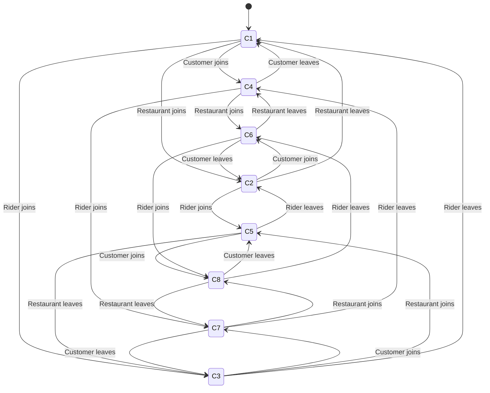

# Requirements analysis: spec

## Summary

- **96 configurations** collapse into **8 behavior classes**
- Behavioral model: 8 states, 24 join/leave transitions
- Encoding: 75 Boolean variables, 358 CNF clauses, 512 SAT checks
- **4 problems found**

Every statement below was proved by the solver. The language model only read the requirements and proposed the model. It did not decide any of this.

## Findings

### 1. Delivery Platform (backend + admin) can be present and still unable to meet its goal

Delivery Platform (backend + admin) is present and provably cannot meet its root goal in behavior classes 1, 2, 3, 4, 6, 7, covering 36 of the 96 configurations. For example `{platform1, paymentprovider1}`.

- Cause: "Route the order to a restaurant" depends on "Fulfill an accepted order" provided by Restaurant Partner with multiplicity `1..*`, and the requirements permit zero of them.
- Cause: "Track the delivery in real time" depends on "Complete a delivery" provided by Delivery Rider with multiplicity `1..*`, and the requirements permit zero of them.

### 2. Delivery Rider can be present and still unable to meet its goal

Delivery Rider is present and provably cannot meet its root goal in behavior classes 3, 7, covering 20 of the 96 configurations. For example `{platform1, paymentprovider1, rider1}`.

- Cause: "Pick the order up at the restaurant" depends on "Fulfill an accepted order" provided by Restaurant Partner with multiplicity `1..*`, and the requirements permit zero of them.

### 3. Customer can be present and still unable to meet its goal

Customer is present and provably cannot meet its root goal in behavior classes 4, 6, 7, covering 27 of the 96 configurations. For example `{platform1, paymentprovider1, customer1}`.

- Cause: "Discover a restaurant and place an order" depends on "Fulfill an accepted order" provided by Restaurant Partner with multiplicity `1..*`, and the requirements permit zero of them.
- Cause: "Receive the food" depends on "Complete a delivery" provided by Delivery Rider with multiplicity `1..*`, and the requirements permit zero of them.

### 4. The minimum configuration does not satisfy every present actor

The system starts as `{platform1, paymentprovider1}`, its minimum configuration. In that state Delivery Platform (backend + admin) is present but unsatisfied.

### Worth a look

- Nothing changes between 1 and 3 Restaurant Partner instances. The range is allowed by the requirements but does not change any outcome in the model.
- Nothing changes between 1 and 5 Delivery Rider instances. The range is allowed by the requirements but does not change any outcome in the model.
- Nothing changes between 1 and 3 Customer instances. The range is allowed by the requirements but does not change any outcome in the model.

## Behavior classes

| Class | Delivery Platform (backend + admin) | Payment Provider (Stripe) | Restaurant Partner | Delivery Rider | Customer | Configurations | Example |
|---|---|---|---|---|---|---|---|
| 1 | no | yes | absent | absent | absent | 1 | `{platform1, paymentprovider1}` |
| 2 | no | yes | yes | absent | absent | 3 | `{platform1, paymentprovider1, restaurant1}` |
| 3 | no | yes | absent | no | absent | 5 | `{platform1, paymentprovider1, rider1}` |
| 4 | no | yes | absent | absent | no | 3 | `{platform1, paymentprovider1, customer1}` |
| 5 | yes | yes | yes | yes | absent | 15 | `{platform1, paymentprovider1, restaurant1, rider1}` |
| 6 | no | yes | yes | absent | no | 9 | `{platform1, paymentprovider1, restaurant1, customer1}` |
| 7 | no | yes | absent | no | no | 15 | `{platform1, paymentprovider1, rider1, customer1}` |
| 8 | yes | yes | yes | yes | yes | 45 | `{platform1, paymentprovider1, restaurant1, rider1, customer1}` |

These are equivalence classes. Every configuration inside one behaves identically, so 8 test scenarios cover all 96 configurations.

## Behavioral model

How the system moves between classes as actors join and leave.

## Traceability

Where each part of the model came from in the source text.

| Element | Requirement |
|---|---|
| Actor Delivery Platform (backend + admin) `1..1` |  |
| Actor Payment Provider (Stripe) `1..1` |  |
| Actor Restaurant Partner `0..3` |  |
| Actor Delivery Rider `0..5` |  |
| Actor Customer `0..3` |  |
| Dependency RouteOrderToKitchen to FulfillOrder `1..*` |  |
| Dependency TrackDelivery to CompleteDelivery `1..*` |  |
| Dependency SettlePayment to AuthorizeCharge `1..*` |  |
| Dependency PickUpOrder to FulfillOrder `1..*` |  |
| Dependency PlaceOrder to FulfillOrder `1..*` |  |
| Dependency ReceiveFood to CompleteDelivery `1..*` |  |
| Dependency PayOnline to AuthorizeCharge `1..*` |  |

---

Model drafted by AI, analysed by GoalShift. The extraction is a draft for review. The analysis is proved.