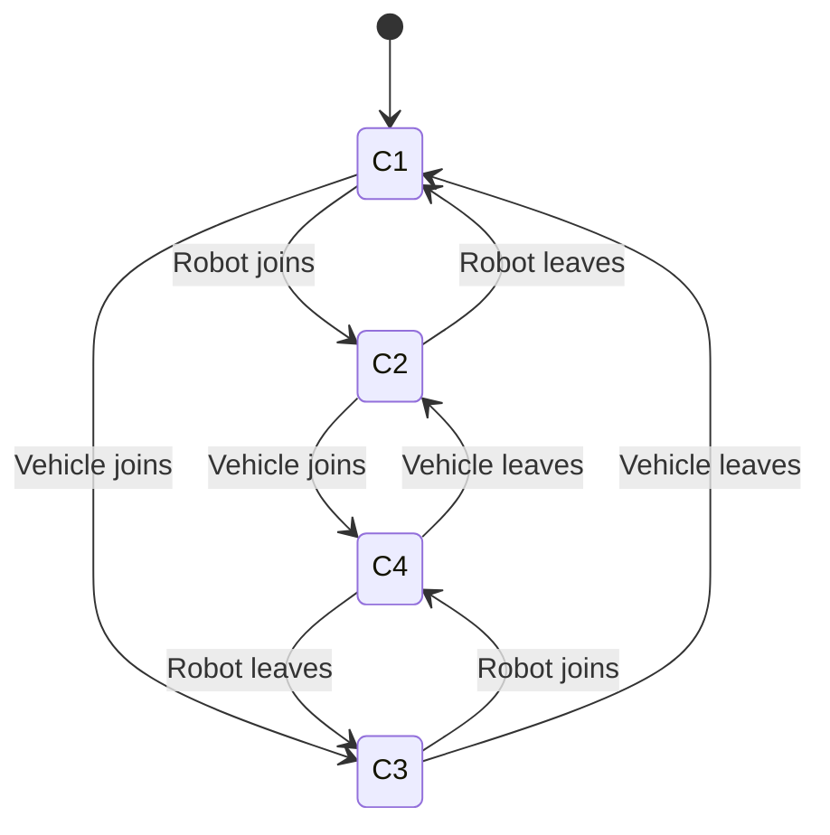

# Requirements analysis: spec

## Summary

- **20 configurations** collapse into **4 behavior classes**
- Behavioral model: 4 states, 8 join/leave transitions
- Encoding: 40 Boolean variables, 126 CNF clauses, 71 SAT checks
- **3 problems found**

Every statement below was proved by the solver. The language model only read the requirements and proposed the model. It did not decide any of this.

## What this means

_Written by Claude from the proved findings below. It rewords them and may not add to them._

### Model as read

| Actor | Cardinality | Source sentence |
|---|---|---|
| Cell Controller | exactly 1 | "The cell is supervised by a single cell controller, which remains powered whenever the line is energised." |
| Welding Robot | 0–4 | "The cell may operate with up to four welding robots... expected to continue operating with a reduced complement." |
| AGT Vehicle | 0–3 | "Up to three vehicles may be assigned to the cell at any one time... may be reassigned to other cells by the plant scheduler." |

Two dependencies, both 1..*:
- `ReceiveWeldedParts` → `WeldAssignedPart` (Robot) — "…only consider a batch part complete once at least one welding robot reports that part as welded."
- `ReceiveRawPart` → `DeliverParts` (Vehicle) — "A robot can only receive its assigned part once at least one transport vehicle has delivered raw stock to the cell."

### Solver result

20 configurations collapse to 4 behavior classes (Controller, Robot, Vehicle):

| Class | Pattern | Configs | Example |
|---|---|---|---|
| 1 | no, absent, absent | 1 | {cellcontroller1} |
| 2 | no, no, absent | 4 | {cellcontroller1, robot1} |
| 3 | no, absent, yes | 3 | {cellcontroller1, vehicle1} |
| 4 | yes, yes, yes | 12 | {cellcontroller1, robot1, vehicle1} |

Only class 4 satisfies every present actor.

### Findings

**1. Cell Controller blocked (classes 1, 2, 3 — 8 configurations).** The controller is present but cannot meet "Receive every welded part back from the cell," because that goal depends on "Weld assigned part" and no robot is present. Responsible sentences: the robot lower bound of zero taken from "Robots are removed from the cell for scheduled maintenance and for retooling between product variants, and the cell is expected to continue operating with a reduced complement," combined with the dependency sentence in 4.4. **Decision required:** does "reduced complement" mean at least one robot must remain in the cell, or is zero robots a legal state? If at least one, the lower bound becomes 1 and this class disappears.

**2. Welding Robot blocked (class 2 — 4 configurations).** A robot is present but cannot meet "Receive the raw part at its station," because that depends on "Deliver parts to the cell" and no vehicle is present. Responsible sentences: the vehicle lower bound of zero from "may be reassigned to other cells by the plant scheduler," combined with "A robot can only receive its assigned part once at least one transport vehicle has delivered raw stock to the cell." **Decision required:** whether the cell must retain a minimum vehicle complement, or whether raw stock can reach a station by some route the document does not describe (infeed buffer, manual load). If neither, robot idling on vehicle reassignment is an accepted behaviour and should be stated as such.

**3. Minimum configuration is degraded.** The smallest legal cell, {cellcontroller1}, leaves the Cell Controller unsatisfied. This follows directly from the controller being always-present ("remains powered whenever the line is energised") while both other actors may be absent. **Decision required:** is an energised cell with no robots and no vehicles an intended operating state, or should the requirements forbid it?

**4. Robot count 1–4 is inert.** Nothing in the model changes between one and four robots.

**5. Vehicle count 1–3 is inert.** Nothing changes between one and three vehicles.

Both inert results follow from the two dependencies reading "at least one." **Decision required:** if the counts are meant to matter (throughput, cycle time, parallel stations), the requirements do not currently say so and need a sentence tying instance count to a goal.

### Assumptions in the extraction that need human confirmation

- **Most consequential:** robot and vehicle lower bounds of 0, read from 4.2 and 4.6. "Continue operating with a reduced complement" and "tolerate the loss of individual robots and vehicles" could equally mean "at least one must remain." Findings 1–3 all turn on this.
- Controller treated as always present; strictly the text conditions this on line energisation, which is outside the modelled system.
- Granularity mismatch: the robot goal is per-part, the controller goal is per-batch. The notation cannot express that a batch contains many parts, so "at least one robot reports *that part* as welded" is flattened to a single actor-level link.
- Ordering is lost. "must first receive the raw part… and must then run the weld program" is captured only as an AND decomposition; same for collecting stock before moving it.
- Weld program choice modelled as XOR on the strength of "never both on the same part," but the sentence says "may run either." XOR forces exactly one; if a robot may run neither, XOR is wrong.
- `ScheduleAllJobs` has no dependency by design, per 4.3 "without assistance from other equipment in the cell." It is an isolated leaf on purpose, not an extraction miss.
- 4.5 "Vehicles operate independently of the welding robots and of each other" is represented only as an absence of links. Read as "a vehicle's own delivery goal needs no robot," not as a denial of the 4.4 dependency it sits in tension with.
- Product variants are referenced twice but modelled as nothing — no goal, no cardinality.
- Infeed buffer, staging area, and batch queue are treated as label wording, not actors. No capacity is stated anywhere in the text.
- No Operator actor despite 4.6's "without requiring an operator restart"; no plant-scheduler actor despite 4.2. Both would require inventing goals the document does not supply.
- Document is Revision C. No earlier revision was supplied, so whether the four-robot and three-vehicle limits changed cannot be checked.

## Findings

### 1. Cell Controller can be present and still unable to meet its goal

Cell Controller is present and provably cannot meet its root goal in behavior classes 1, 2, 3, covering 8 of the 20 configurations. For example `{cellcontroller1}`.

- Cause: "Receive every welded part back from the cell" depends on "Weld assigned part" provided by Welding Robot with multiplicity `1..*`, and the requirements permit zero of them.

### 2. Welding Robot can be present and still unable to meet its goal

Welding Robot is present and provably cannot meet its root goal in behavior class 2, covering 4 of the 20 configurations. For example `{cellcontroller1, robot1}`.

- Cause: "Receive the raw part at its station" depends on "Deliver parts to the cell" provided by Automated Guided Transport Vehicle with multiplicity `1..*`, and the requirements permit zero of them.

### 3. The minimum configuration does not satisfy every present actor

The system starts as `{cellcontroller1}`, its minimum configuration. In that state Cell Controller is present but unsatisfied.

### Worth a look

- Nothing changes between 1 and 4 Welding Robot instances. The range is allowed by the requirements but does not change any outcome in the model.
- Nothing changes between 1 and 3 Automated Guided Transport Vehicle instances. The range is allowed by the requirements but does not change any outcome in the model.

## Behavior classes

| Class | Cell Controller | Welding Robot | Automated Guided Transport Vehicle | Configurations | Example |
|---|---|---|---|---|---|
| 1 | no | absent | absent | 1 | `{cellcontroller1}` |
| 2 | no | no | absent | 4 | `{cellcontroller1, robot1}` |
| 3 | no | absent | yes | 3 | `{cellcontroller1, vehicle1}` |
| 4 | yes | yes | yes | 12 | `{cellcontroller1, robot1, vehicle1}` |

These are equivalence classes. Every configuration inside one behaves identically, so 4 test scenarios cover all 20 configurations.

## Behavioral model

How the system moves between classes as actors join and leave.

## Traceability

Where each part of the model came from in the source text.

| Element | Requirement |
|---|---|
| Actor Cell Controller `1..1` | The cell is supervised by a single cell controller, which remains powered whenever the line is energised. |
| Actor Welding Robot `0..4` | The cell may operate with up to four welding robots. Robots are removed from the cell for scheduled maintenance and for retooling between product variants, and the cell is expected to continue operating with a reduced complement. |
| Actor Automated Guided Transport Vehicle `0..3` | Up to three vehicles may be assigned to the cell at any one time. Vehicles are dispatched from a shared fleet and may be reassigned to other cells by the plant scheduler. |
| Dependency ReceiveWeldedParts to WeldAssignedPart `1..*` | The controller shall only consider a batch part complete once at least one welding robot reports that part as welded. |
| Dependency ReceiveRawPart to DeliverParts `1..*` | A robot can only receive its assigned part once at least one transport vehicle has delivered raw stock to the cell. |

## Extraction caveats

Raised by the model that read the requirements. These are its own uncertainties about the extraction, not solver results.

- Robot lo=0 and Vehicle lo=0 are my reading of 4.2 and 4.6 ('Robots are removed from the cell...', 'may be reassigned to other cells', 'The cell shall tolerate the loss of individual robots and vehicles'). The text never states a minimum complement, and 'continue operating with a reduced complement' and 'loss of individual robots' could plausibly mean 'at least one must remain' rather than 'zero is allowed'. This is the single most consequential assumption in the model and should be confirmed by a human.
- CellController lo=1, hi=1 comes from 'a single cell controller, which remains powered whenever the line is energised'. I read 'remains powered whenever the line is energised' as always-present within the scope of this analysis; strictly, it is conditional on line energisation, which is outside the modelled system.
- The Robot root goal is per-part ('weld its assigned part') while the Controller root goal is per-batch ('complete a production batch'). The notation has no way to express this difference in granularity, or the fact that a batch contains many parts. The dependency ReceiveWeldedParts -> WeldAssignedPart therefore flattens a per-part condition ('at least one welding robot reports THAT PART as welded') into a single actor-level link.
- Ordering constraints are not representable. 'must first receive the raw part ... and must then run the weld program' is captured only as an AND decomposition; the sequencing is lost. Same for 'collecting stock ... and moving it', where collection obviously precedes the move.
- 'A robot may run either the standard weld program or the high-strength weld program' uses 'may', which reads as permission rather than obligation. I modelled it as XOR because of the explicit 'but never both on the same part', but XOR forces exactly one to be chosen, which is stronger than 'may'. If the intent is that a robot might run neither, XOR is wrong.
- 4.3 says 'The controller schedules jobs from the batch queue without assistance from other equipment in the cell.' I read this as an explicit instruction NOT to create a dependency from ScheduleAllJobs, so it has none. Flagging it because an isolated leaf can look like an extraction miss.
- Both dependencies use 1..* because both source sentences say 'at least one'. Nothing in the text implies *..* anywhere, so no *..* dependency appears in the model.
- 'Vehicles operate independently of the welding robots and of each other' (4.5) is a negative statement — an absence of dependencies. I have represented it only by not linking Vehicle goals to Robot goals. It is worth noting that this sits in tension with 4.4, where a robot's ReceiveRawPart does depend on vehicle delivery; I read 4.5 as 'a vehicle's own delivery goal needs no robot', not as a denial of the 4.4 dependency.
- 'Robots are removed from the cell ... for retooling between product variants' and 'the weld program for the current variant' both reference product variants, but variants are not modelled as anything (no goal, no cardinality). There is no obvious place for them in this notation.
- The infeed buffer, the staging area, and the batch queue are treated as wording inside task labels, not as actors. They appear to be passive resources rather than participants, but if the downstream analysis needs buffer capacity, none is stated in the text.
- 4.6 'without requiring an operator restart' implies an operator exists somewhere in the system, but no operator goal or responsibility is described here, so I did not create an Operator actor. Likewise the 'plant scheduler' in 4.2 dispatches and reassigns vehicles but is outside cell WC-3; creating an actor for it would mean inventing goals the document does not give.
- The document is Revision C; no earlier revision was supplied, so I cannot tell whether any of these cardinalities (four robots, three vehicles) changed from a previous revision.

---

Model extracted by Claude, analysed by GoalShift. The extraction is a draft for review. The analysis is proved.